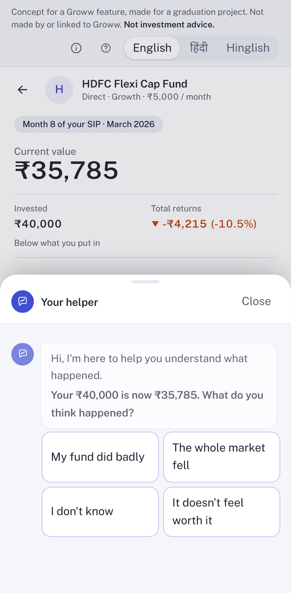
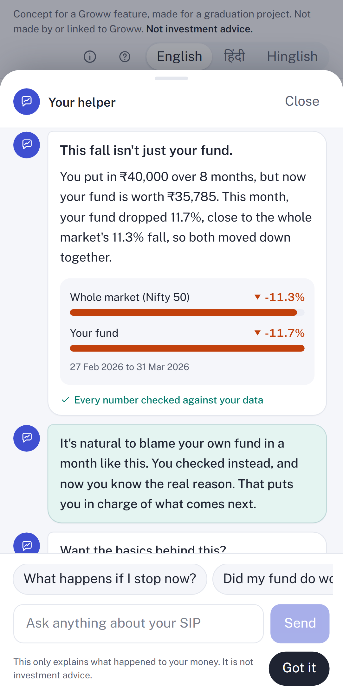
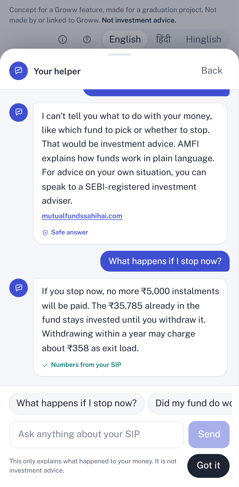
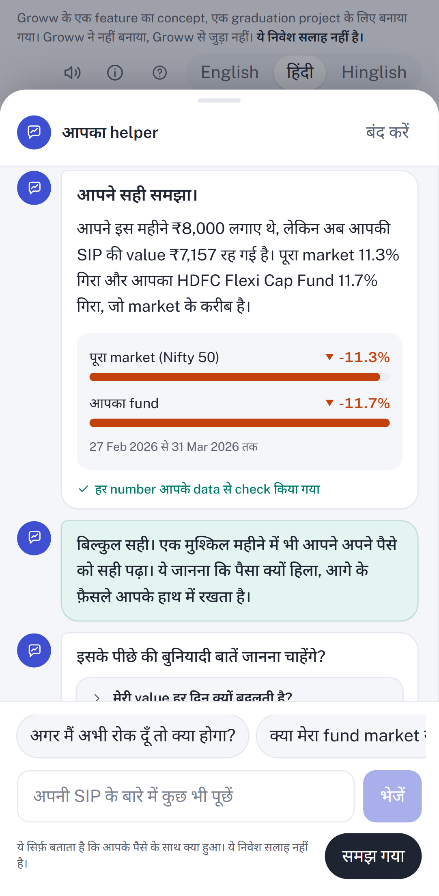
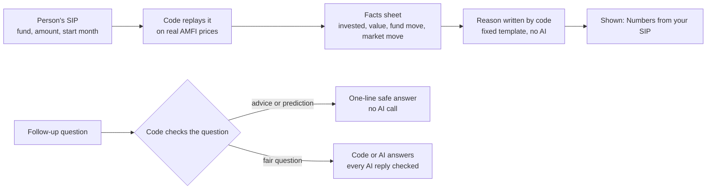

# Your SIP, explained

A helper for first-time SIP investors that explains their **own** first fall, in English, Hindi or Hinglish, at the moment they see it.

A concept for a Groww-style SIP page, built for a product management graduation project. Not made by or linked to Groww. **Not investment advice.**

| | |
|---|---|
| **Live app** | [sip-ai-mvp.vercel.app](https://sip-ai-mvp.vercel.app/) |
| **Architecture** | [docs/ARCHITECTURE.md](docs/ARCHITECTURE.md): how a SIP becomes a checked explanation |
| **User testing** | [docs/USER-TESTING.md](docs/USER-TESTING.md): who tried it, where they got stuck, what we change |
| **The proof behind it** | [Design thesis](https://sip-ai-mvp.vercel.app/design) · [Cohort proof](https://sip-ai-mvp.vercel.app/cohorts) · [Experiment plan](https://sip-ai-mvp.vercel.app/experiment) |
| **Decisions** | [docs/adr/](docs/adr/): 7 short decision records |
| **SIP maths by hand** | [docs/reference/hand-checks.md](docs/reference/hand-checks.md) |

## The problem it solves

In our research, the step where first-time SIP investors drop off most is **months 4 to 12**: only about half keep paying through it, and the stop often comes right after their first fall. In our survey, 3 of the 8 first-timers still paying at month 3 stopped after a fall. The app shows them the drop, but never the reason, so a normal market fall looks like their own mistake.

The helper does one job: it makes that first fall readable. It never tells anyone to keep going, and the Stop button stays exactly where it was.

## What it does, in three steps

| 1. Ask first | 2. Show the reason | 3. Answer, never advise | Same in Hindi |
|---|---|---|---|
|  |  |  |  |
| At the first month-end in months 4 to 12 when the value is below what was put in, the helper asks what they think happened (four taps). | Their fund against the whole market (Nifty 50) for the same month, with every number checked against their SIP. | Follow-up questions are answered from their own numbers. "Should I switch?" gets a fixed safe answer that points to AMFI and a SEBI-registered adviser. | English, Hindi and Hinglish, switchable at any time. |

## How it works

**Numbers and the reason from code, follow-up answers from AI.** Every number comes from real AMFI fund prices (via mfapi.in) and is worked out in code. The reason that explains what moved the value is written by code from a fixed template, in English, Hindi and Hinglish. The AI (OpenAI gpt-4.1-mini) only answers follow-up questions from a fixed list of facts. Code checks every AI reply before it is shown. A reply that fails shows a code-written line instead.



The full picture, with every part and why it is built that way, is in [docs/ARCHITECTURE.md](docs/ARCHITECTURE.md).

## How we know it works

| Check | How | Result |
|---|---|---|
| Unit tests, written before the code (TDD) | Every piece of logic got its test first, and every task ended with tests and build passing | **525 of 525 pass** (29 files) |
| End-to-end, phone and desktop | Playwright walks the real app: sample SIP, the helper, Hindi, the tour, Stop and Withdraw | **16 of 16 pass** (2 are phone-only or desktop-only and skip on the other screen) |
| SIP maths by hand | 4 SIPs worked out with a calculator, and each one is also a test | **4 of 4 match** ([hand checks](docs/reference/hand-checks.md)) |
| Advice and predictions blocked | 25 test questions in English, Hinglish and Hindi | **25 of 25 blocked**, and 8 of 8 fair questions still answered |
| Bad AI replies caught | Replies with an invented number, advice, a prediction, an em dash or too long | **8 of 8 caught** |
| People | 1 finance expert and 2 testers, founder-led, 3 and 4 Nov 2026 | 3 problems found, fixes shipped in version 2 ([user testing](docs/USER-TESTING.md)) |
| Eval gate | 40 questions and 20 SIP situations, pass lines fixed in advance ([ADR-0006](docs/adr/0006-release-only-through-the-eval-gate.md)) | **Run six times.** Version 1 failed at 16 of 20. Versions 2 to 6 pass at 20 of 20, 0 wrong numbers ([latest report](docs/evals/2026-11-07-eval-v6.md)) |

What is still open, said plainly: 2 of the 3 people who tried it are in our segment (the third is an expert), testers have not retried version 2 yet, and the before-and-after test has not been run. All 60 final eval rows are code or fixed text, so AI follow-ups are held by the reply guard and the number check, not by those rows. The two lines the founder scores by hand are open on version 6.

## Run it

```bash
npm install
cp .env.example .env.local   # then add OPENAI_API_KEY
npm run dev                  # http://localhost:3000
npm test                     # unit tests (Vitest)
npm run build
npx playwright test          # end-to-end tests, phone and desktop (starts the built app on port 3100)
```

## Deploy (Vercel)

1. Import the repo in Vercel (framework: Next.js, no build settings to change).
2. Add the environment variable `OPENAI_API_KEY` in the Vercel project settings. It is never in the repo.
3. In the project's **Analytics** tab, enable Web Analytics. The app already includes `@vercel/analytics` and sends anonymous events only (no questions, answers, funds or amounts).

## Where things are

| Folder | What is in it |
|---|---|
| `src/lib/sip` | The SIP engine: instalments, units, month-end value, the first fall |
| `src/lib/guard` | The two safety locks: the question check and the reply check |
| `src/lib/ai` | The only place the AI is called |
| `src/lib/helper` | Which case a fall is, and the words of the reason |
| `src/lib/copy` | Every line of text, in English, Hindi and Hinglish |
| `src/app` | The app, the API routes and the three proof pages |
| `docs/` | Architecture, decisions, user testing, hand checks, screenshots |
| `e2e/` | End-to-end tests |

Read `GLOSSARY.md`, `docs/adr/` and `TODO.md` before changing anything.
