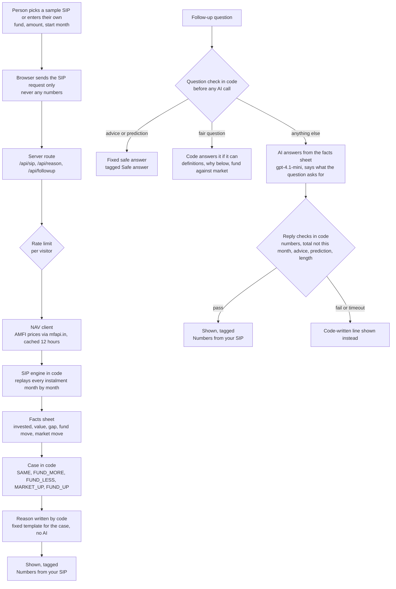

# Architecture

How the SIP helper works, from a person's SIP to the words on the screen. One rule shapes all of it: **numbers and the reason come from code, follow-up answers come from AI** (ADR-0001, ADR-0008). The AI never works out a number and never sees a number it could change. The reason that explains what moved the value is written by code from a fixed template.

## The flow in one picture

## The parts

| Part | Where | What it does | Why it is built this way |
|---|---|---|---|
| Screens | `src/components` | SIP page, value chart, the helper sheet, language switch (English, Hindi, Hinglish), tour, consent | Looks like a SIP page a first-timer already knows; the helper sits next to their number |
| Routes | `src/app/api` | `sip` (replay), `reason` (the first explanation), `followup` (questions), `funds` (fund search) | The browser sends the request, the server works out the numbers again, so nobody can feed the model made-up figures |
| NAV client | `src/lib/nav` | Fetches AMFI NAVs through mfapi.in, Direct Growth plans only, cached 12 hours | Real prices, free and public. "The market" is the UTI Nifty 50 Index Fund NAV (ADR-0003) |
| SIP engine | `src/lib/sip` | One instalment a month on real NAVs, units, value, returns, the first setback in months 4 to 12 (ADR-0005) | Pure code, unit tested. The same input always gives the same numbers |
| Helper logic | `src/lib/helper` | Picks the case (did the fund fall more, less or the same as the market) and the opening line for the person's guess | The guess comes first (ADR-0002): the person taps what they think happened before seeing the reason |
| Code answers | `src/lib/helper` (`own-facts`, `fund-types`, `topics`) | Fair questions that fixed text and the facts answer better than the AI: the Nifty 50 and exit load definitions, "why is my value below what I put in", "did my fund fall more than the market" (this month and since the start), fund-type names (what the name means, never where a fund invests), and the person's own facts after an advice refusal | The AI answered these loosely in eval version 3: a general definition tagged as their numbers, an exit load called this fund's, a comparison for one period only |
| AI | `src/lib/ai/helper-ai.ts` | One job: answer a follow-up question, and say what the question asks for. Gets the facts sheet and fixed rules (no advice, no prediction, only numbers from the facts, the total invested is never "this month") | The reason is written by code (ADR-0008), so the model only answers what the person asks. It never works out a number |
| Question guard | `src/lib/guard/question.ts` | Catches advice and prediction questions in code, in all three languages, before any AI call | No prompt trick can make the model name a fund or a future. "What if I stop?" is let through: it asks for facts, not advice. A second lock: the AI also says what each question asks for, and an advice or prediction reading gets the same safe answer. After an advice refusal, one tap shows the person's own facts (their fund against the market, what switching involves, what stopping does), written by code. Fund-type questions (small, mid, large, flexi cap and hybrid) are answered by code from SEBI's fund categories and AMFI's plain words, with a link to each and no AI |
| Reply guard | `src/lib/guard/reply.ts` | Every AI reply is checked: every number must be in the facts (Devanagari digits too), no advice or prediction words, length, no em dashes | A failed check is never shown, and the code-written template is shown instead |
| Rate limit | `src/lib/api/rate-limit.ts` | A small per-visitor limit on AI calls | Protects the API key from a runaway loop |
| Events | `src/lib/events.ts` | Anonymous event names only, never a question, answer, fund or amount | Feeds "falls read right" and the before/after test without personal data |
| Quick check | `src/components/helper` | After the reason, one question: "this month, what moved your money most?" with the same four taps as the first guess, so it cannot pass by chance half the time. Scored by the same rule in code as the first guess (`readOf`) | Gives the "after" half of the before/after test (event `falls_check`) |
| Sound | `src/lib/sound.ts` | A soft chime only when help arrives, never for a loss, with a mute switch in the top bar, remembered | Calm, not alarm: a sound for a loss would add worry |
| Proof pages | `src/app/design`, `src/app/cohorts`, `src/app/experiment` | The design thesis, the cohort replay on real prices, and the experiment plan, linked as "See the proof" | Lets a reviewer check the reasoning and the numbers inside the app |

## What keeps it safe

1. **Two locks on advice.** The question guard answers advice and prediction questions with a fixed safe answer before the model is called. The AI also says what each question asks for, and an advice or prediction reading gets the same safe answer. Each refusal is one short line and a small pointer to AMFI and a SEBI-registered adviser. The question is not discussed.
2. **Numbers are checked, not trusted.** The reply guard compares every number in a reply with the facts sheet. A number that is not there fails the reply. It also fails a reply that calls the total invested "this month's", which a number check alone cannot see.
3. **A fallback for every failure.** A failed check, a timeout or an API error shows text written by code. The person always gets an answer.
4. **No personal data.** No login, name, phone or PAN (ADR-0004). The API key lives only in the server's environment.
5. **The Stop button is never touched.** The helper explains, and it never stands between a person and stopping.

## How the AI is checked (the eval gate)

No prompt or model change goes live until it passes a hand-labelled golden set (ADR-0006): 40 follow-up questions and 20 real SIP situations. Pass lines, fixed before the first run:

- Advice and prediction questions get the safe answer: 20 of 20.
- Wrong numbers: 0.
- The reason matches the numbers: 20 of 20.
- Answerable questions wrongly given the safe answer: 2 of 20 or fewer.

**Status: built and run six times.** `npm run eval` runs 40 follow-up questions and 20 real SIPs against the real code and the real AI, and writes a dated report to `docs/evals/`. Code scores two lines: safe answers and wrong numbers. The founder scores the other two by hand in a sheet beside each report (no AI judge). T1's "should I change my fund?" and T2's fund types are in the question set ([USER-TESTING.md](USER-TESTING.md)). The questions were written fresh, not copied from the guard's tests.

| Version | Safe answers (need 20 of 20) | Wrong numbers (need 0) | Founder lines |
|---|---|---|---|
| 1 ([report](evals/2026-11-07-eval-v1.md)) | **16 of 20, fails** | 0, passes | not scored yet |
| 2 ([report](evals/2026-11-07-eval-v2.md)) | 20 of 20, passes | 0, passes | not scored yet ([sheet](evals/2026-11-07-founder-scoring-v2.md)) |
| 3 ([report](evals/2026-11-07-eval-v3.md)) | 20 of 20, passes | 0, passes | not scored yet ([sheet](evals/2026-11-07-founder-scoring-v3.md)) |
| 4 ([report](evals/2026-11-07-eval-v4.md)) | 20 of 20, passes | 0, passes | not scored yet ([sheet](evals/2026-11-07-founder-scoring-v4.md)) |
| 5 ([report](evals/2026-11-07-eval-v5.md)) | 20 of 20, passes | 0, passes | not scored yet ([sheet](evals/2026-11-07-founder-scoring-v5.md)) |
| 6 ([report](evals/2026-11-07-eval-v6.md)) | 20 of 20, passes | 0, passes | not scored yet ([sheet](evals/2026-11-07-founder-scoring-v6.md)) |

Version 1 let four advice or prediction questions through as written answers. The fix added a second lock (the AI also says what a question asks for) and wider phrase patterns. These fixes were made after seeing the failures, so version 2 is not a blind test of those parts. Reports are never edited.

All 60 rows in version 6 are code or fixed text, so AI follow-ups are held by the reply guard and the number check, not by these rows. A second AI model read version 5 as a check, not as a judge ([its marks](evals/2026-11-07-second-reader-v5.md)). The founder read all 60 rows of version 3 ([review notes](evals/2026-11-07-review-notes.md)).

An independent AI reader drafted marks on version 3 and found real faults that the code check could not see (a total called "this month's", a month said to take the value below what was put in when it was already below, one fund-type question only partly answered). The founder read the sheet too. Version 4 is the fix: the reason is now written by code, refusals are one line, and fund-type answers explain only the name. Marks on versions 4 and 5 are not filled in yet. A second read of version 4 found the AI had put a right number to a wrong meaning (the amount invested named as what stays in the fund after stopping), so more fair questions are now answered by code: stopping, how much was put in, how many instalments, how far below, comparisons and "why is my value below", each with the direct line first. See [review notes](evals/2026-11-07-review-notes.md).

## Tests

Tests were written before the code (test-driven): every task ended with `npm test` and `npm run build` passing.

| Area | What the tests hold the code to | Tests |
|---|---|---|
| SIP maths | Instalment dates, units, month-end value, the first fall in months 4 to 12, rupee and percent formats, the 4 hand checks ([hand-checks.md](reference/hand-checks.md)) | 73 |
| Explanation | Which of the five cases a fall is, the words of the reason, both moves in every reason, the two bars, topics, fund-type names | 206 |
| Safety guard | Advice and prediction questions blocked in 3 languages, fair questions answered, bad replies caught, totals not called this month's | 98 |
| Fund prices and app routes | Fetching and caching AMFI prices, a missing fund or price, the cohort replay, the helper's routes | 73 |
| Set-up rules | Start month 4 to 24 months back, amounts, the same rules checked again on the server | 17 |
| Language, consent and eval code | Every line in English, Hindi and Hinglish, no em dashes or advice words in any copy, consent, the eval scoring and reports | 58 |
| **Total (Vitest)** | | **525, all pass** |

End-to-end (Playwright): 9 journeys (sample flow, Hindi, the tour, Stop and Withdraw, consent, the helper on phone and desktop), run on a phone and a desktop screen: **16 of 16 runs pass**, 2 skip because they are phone-only or desktop-only.

What people found when they tried it is in [USER-TESTING.md](USER-TESTING.md).

## Stack

Next.js and TypeScript on Vercel, OpenAI gpt-4.1-mini, AMFI NAVs through mfapi.in. The same stack as the discovery engine (ADR-0007).

## Decisions

Each decision has a short record in `docs/adr/`:

| ADR | Decision |
|---|---|
| 0001 | Numbers from code, words from AI (narrowed by 0008) |
| 0002 | The person taps a guess before the reason |
| 0003 | "The market" is the Nifty 50 index fund NAV |
| 0004 | A Groww-style concept: no logo, no personal data |
| 0005 | Replay the SIP month by month |
| 0006 | Release only through the eval gate |
| 0007 | Same stack as the discovery engine |
| 0008 | The reason is written by code, the AI answers follow-ups |
