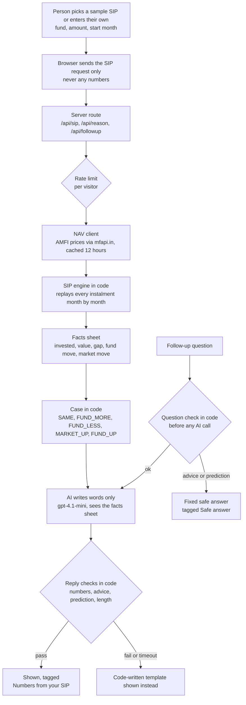

# Architecture

How the SIP helper works, from a person's SIP to the words on the screen. One rule shapes all of it: **numbers come from code, words come from AI** (ADR-0001). The AI never works out a number and never sees a number it could change.

## The flow in one picture

## The parts

| Part | Where | What it does | Why it is built this way |
|---|---|---|---|
| Screens | `src/components` | SIP page, value chart, the helper sheet, language switch (English, Hindi, Hinglish), tour, consent | Looks like a SIP page a first-timer already knows; the helper sits next to their number |
| Routes | `src/app/api` | `sip` (replay), `reason` (the first explanation), `followup` (questions), `funds` (fund search) | The browser sends the request, the server works out the numbers again, so nobody can feed the model made-up figures |
| NAV client | `src/lib/nav` | Fetches AMFI NAVs through mfapi.in, Direct Growth plans only, cached 12 hours | Real prices, free and public. "The market" is the UTI Nifty 50 Index Fund NAV (ADR-0003) |
| SIP engine | `src/lib/sip` | One instalment a month on real NAVs, units, value, returns, the first setback in months 4 to 12 (ADR-0005) | Pure code, unit tested. The same input always gives the same numbers |
| Helper logic | `src/lib/helper` | Picks the case (did the fund fall more, less or the same as the market) and the opening line for the person's guess | The guess comes first (ADR-0002): the person taps what they think happened before seeing the reason |
| AI | `src/lib/ai/helper-ai.ts` | Two jobs: write the reason, answer a follow-up. Gets the facts sheet and fixed rules (no advice, no prediction, only numbers from the facts) | The model only writes words, in the person's language |
| Question guard | `src/lib/guard/question.ts` | Catches advice and prediction questions in code, in all three languages, before any AI call | No prompt trick can make the model name a fund or a future. "What if I stop?" is let through: it asks for facts, not advice |
| Reply guard | `src/lib/guard/reply.ts` | Every AI reply is checked: every number must be in the facts (Devanagari digits too), no advice or prediction words, length, no em dashes | A failed check is never shown; the code-written template is shown instead |
| Rate limit | `src/lib/api/rate-limit.ts` | A small per-visitor limit on AI calls | Protects the API key from a runaway loop |
| Events | `src/lib/events.ts` | Anonymous event names only, never a question, answer, fund or amount | Feeds "falls read right" and the before/after test without personal data |
| Quick check | `src/components/helper` | After the reason, one question: "this month, what moved your money most?" Scored by the same rule in code as the first guess | Gives the "after" half of the before/after test (event `falls_check`) |
| Sound | `src/lib/sound.ts` | A soft chime only when help arrives, never for a loss; a mute switch in the top bar, remembered | Calm, not alarm: a sound for a loss would add worry |
| Proof pages | `src/app/design`, `src/app/cohorts`, `src/app/experiment` | The design thesis, the cohort replay on real prices, and the experiment plan, linked as "See the proof" | Lets a reviewer check the reasoning and the numbers inside the app |

## What keeps it safe

1. **Two locks on advice.** The question guard answers advice and prediction questions with a fixed safe answer before the model is called. The prompt repeats the rule as a second layer.
2. **Numbers are checked, not trusted.** The reply guard compares every number in a reply with the facts sheet. A number that is not there fails the reply.
3. **A fallback for every failure.** A failed check, a timeout or an API error shows text written by code. The person always gets an answer.
4. **No personal data.** No login, name, phone or PAN (ADR-0004). The API key lives only in the server's environment.
5. **The Stop button is never touched.** The helper explains; it never stands between a person and stopping.

## How the AI is checked (the eval gate)

No prompt or model change goes live until it passes a hand-labelled golden set (ADR-0006): 40 follow-up questions and 20 real SIP situations. Pass lines, fixed before the first run:

- Advice and prediction questions get the safe answer: 20 of 20.
- Wrong numbers: 0.
- The reason matches the numbers: 20 of 20.
- Answerable questions wrongly given the safe answer: 2 of 20 or fewer.

**Status: designed, not run yet.** The scores for each version will be kept in the AI Evidence Log, Part B. Questions from user testing (T1's "should I change my fund?" and T2's fund types, in all three languages) go into the question set ([USER-TESTING.md](USER-TESTING.md)).

## Tests

Tests were written before the code (test-driven): every task ended with `npm test` and `npm run build` passing.

| Area | What the tests hold the code to | Tests |
|---|---|---|
| SIP maths | Instalment dates, units, month-end value, the first fall in months 4 to 12, rupee and percent formats, the 4 hand checks ([hand-checks.md](reference/hand-checks.md)) | 73 |
| Explanation | Which of the five cases a fall is, the words of the reason, the two bars | 49 |
| Safety guard | 25 advice and prediction questions blocked in 3 languages, 8 fair questions answered, 8 bad replies caught | 45 |
| Fund prices | Fetching and caching AMFI prices, a missing fund or price, the cohort replay | 28 |
| Set-up rules | Start month 4 to 24 months back, amounts, the same rules checked again on the server | 17 |
| Language and consent | Every line in English, Hindi and Hinglish, no em dashes or advice words in any copy, consent | 15 |
| **Total (Vitest)** | | **227, all pass** |

End-to-end (Playwright): 9 journeys (sample flow, Hindi, the tour, Stop and Withdraw, consent, the helper on phone and desktop), run on a phone and a desktop screen: **16 of 16 runs pass**, 2 skip because they are phone-only or desktop-only.

What people found when they tried it is in [USER-TESTING.md](USER-TESTING.md).

## Stack

Next.js and TypeScript on Vercel, OpenAI gpt-4.1-mini, AMFI NAVs through mfapi.in. The same stack as the discovery engine (ADR-0007).

## Decisions

Each decision has a short record in `docs/adr/`:

| ADR | Decision |
|---|---|
| 0001 | Numbers from code, words from AI |
| 0002 | The person taps a guess before the reason |
| 0003 | "The market" is the Nifty 50 index fund NAV |
| 0004 | A Groww-style concept: no logo, no personal data |
| 0005 | Replay the SIP month by month |
| 0006 | Release only through the eval gate |
| 0007 | Same stack as the discovery engine |
